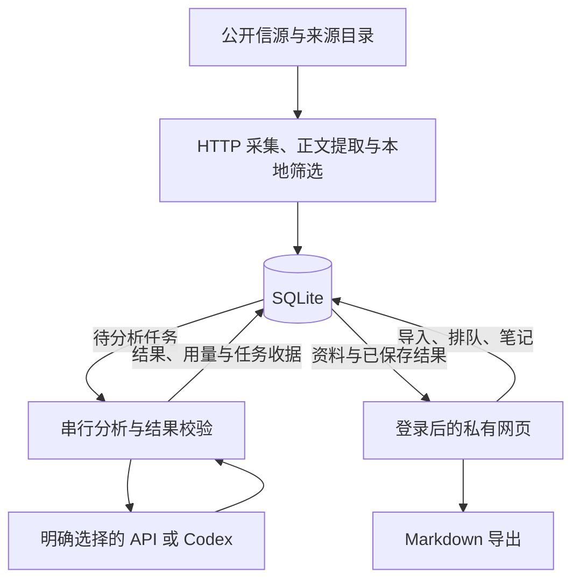

# FDE 研究台架构

## 2.3.1 主动发现与每日研究

`worker.mjs` 在既有定时采集开关下触发 `Discovery.refresh`。HN 分支每轮读取一个主题的一页，GitHub 分支调用既有仓库跟踪。两者和普通来源共享本机代理配置，线索只写入线索池。原文收录仍走现有入口。自动分析的开关、入队规则、串行执行和滚动用量与线索调度分开。

`subscriptions.mjs` 在 `settings` 存储每个 HN 主题的配置、成功检查时刻、已覆盖上界、未完分页及失败冷却。原文链接与讨论链接经现有研究用 URL 规则归并。停机、分页和同一线索重查不产生新的研究卡。

SQLite schema 5 给线索出处增加作者与活动依据字段，新增 `research_feedback` 表。反馈按标准化原文分组，偏好存入原有设置表。日报由 `daily.mjs` 查库生成。工程规则提供可解释的优先级，近期反馈只调整推荐排序。历史日期查询随现有评审状态更新，不额外保存每日副本，也不调用模型。

## 2.2.0 公众号草稿扩展

原采集与研究链不变。新链为：已分析资料 → 保存写作快照 → 同一串行 worker 完成一次写作 → 保存正文 → 本地渲染文字/图文 → 用户编辑、下载与核对。素材整理模式跳过模型，直接保存明确标注的素材稿。

- `src/editorial.mjs`：个人规则、输入快照、写作指纹、Schema、来源编号校验和素材稿。只通过 `analysis.mjs` 的受限 transport 调模型。
- `src/editorial-render.mjs`：固定结构转 TXT/Markdown/内联 HTML 和安全 SVG；无联网与模型操作。
- `public/editorial-assets.js`：用户浏览器 Canvas 生成 PNG、双版本 ZIP 和纯文字富文本复制。服务器不安装图形浏览器。
- `public/editorial.*` 与 `/api/editorial`：独立草稿页、结构化编辑、修订冲突、私有预览和下载。内联样式只在禁止脚本/连接的专门预览响应中允许，不放开主应用策略。
- SQLite schema 2 增量新增 `editorial_drafts` 以及 `attempts.kind/draft_id`。研究卡、写作正文和人工编辑分开；同一本 attempts 账本继续决定并发、次数、预算和未知恢复。

只有确定性渲染后的 HTML/SVG 被预览；模型不输出任意 HTML、脚本或图片链接。来源哈希与分析 key 跟随草稿保存，材料更新只标记旧稿快照已过期，不自动调用模型。人工编辑需要 revision 匹配，不能覆盖另一个窗口刚保存的正文。

更新前必须在旧代码上备份，详见 [迁移与回滚](OPERATIONS.md#220-草稿数据库升级)。新增功能及外部项目取舍见 [WECHAT_DESIGN_REVIEW](WECHAT_DESIGN_REVIEW.md)。后文描述既有研究链；公众号草稿和配图不属于公开发布层。

本版是一个独立的个人研究入口：**一个 Node.js 进程、一个 SQLite 数据库、一套需要登录的网页**。它沿用 AIHOT“采集 → 入库 → 分析 → 展示”的思路，把主要产物收敛为可追溯的研究卡、个人笔记和公众号选题，再由用户导出开展写作。

运行入口是 `fde-workbench/` 自己的 `package.json`、配置和数据目录。当前实现不调用原项目的 PostgreSQL worker、公开内容发布层或旧版多轮评分任务。原 AIHOT 文件保留在仓库中用于对照；部署本版时，应使用个人研究台自己的入口和环境变量。这个决定直接对应个人使用需求：容易部署，模型调用可控，失败可以复核，资料和笔记留在同一个地方。

本文描述当前代码的实际行为。模型接入与计费细节见 [MODEL_USAGE.md](MODEL_USAGE.md)，来源与采集证据见 [SOURCES.md](SOURCES.md)，页面操作见 [EDITORIAL_WORKFLOW.md](EDITORIAL_WORKFLOW.md)。

## 1. 整体结构

网页读取的是数据库中的资料和结果。打开页面、搜索、修改笔记、标记选题进度或导出，不会因此启动模型。用户排队分析，或者明确开启自动分析后，后台任务才可能调用所选模型。采集、分析、自动分析是三个独立开关，默认都关闭。依据：[配置](../src/config.mjs)、[HTTP 接口](../src/server.mjs)、[任务调度](../src/worker.mjs)。

### 模块职责

| 位置 | 负责什么 | 主要边界 |
|---|---|---|
| [`src/main.mjs`](../src/main.mjs) | 获取运行锁，打开数据库，恢复中断记录，启动网页与任务循环，处理退出 | 同一数据目录只运行一个研究台实例 |
| [`src/config.mjs`](../src/config.mjs) | 读取运行配置、校验开关与来源种子 | 模型方式明确选择；来源地址必须是无凭据的 HTTPS 地址 |
| [`src/fetch.mjs`](../src/fetch.mjs) | 网络请求、URL 规范化、目标地址校验、跳转和大小限制 | 只读取公开文字内容；不运行网页脚本 |
| [`src/collect.mjs`](../src/collect.mjs) | 解析 RSS/Atom 或 HTML 列表，提取正文、原始日期，手动导入 | 没有正文就保留待补状态；未知日期不补造 |
| [`src/store.mjs`](../src/store.mjs) | 保存资料、来源状态、选题状态、分析结果、用量和收据 | 用数据库事务维护任务、预算和缓存状态 |
| [`src/worker.mjs`](../src/worker.mjs) | 按周期检查来源，从队列逐篇分析，定期整理原始候选 | 同时最多一个模型任务；失败模型任务不自动重排 |
| [`src/analysis.mjs`](../src/analysis.mjs) | 本地准入、输入截断、分析指纹、模型调用、结构与原文证据校验 | 一次有界任务生成一份研究结果，不让模型自行浏览或扩展任务 |
| [`src/server.mjs`](../src/server.mjs) 与 [`public/`](../public/) | 登录、资料库、信源、用量、笔记与导出 | 研究数据需要认证；没有向公众号或网站发布文章的接口 |

## 2. 一篇资料怎样进入研究库

### 2.1 自动来源

`worker` 约每分钟检查一次运行条件，并根据每个来源的 `nextFetchAt` 决定是否读取。采集按来源逐个进行。网页上的“检查信源更新”同样遵守来源间隔，多次点击不会强制连续刷新同一站点。

RSS 来源由 XML 解析器检查格式，同时支持 Atom。HTML 来源只读取服务器返回的静态页面，按配置的 CSS 选择器找文章卡片。链接再经过 URL 去重、路径规则和文章域名白名单。每个来源默认保留前 8 条候选，配置上限受代码限制；这不是全站镜像，也不保证扫描所有历史页。

已有 URL 直接跳过。新 URL 尝试读取详情，再用 Readability 和页面语义标签抽取纯文本。详情不足或失败时，如果原站订阅提供至少 600 字符内容，可以按 `feed_excerpt` 保存；否则以 `missing` 和“待补正文”保存。订阅内容可用不等于详情已通过，分析时会保留仅依据已提供部分的限制。

日期优先来自详情的 `datePublished`、`article:published_time` 或已配置的原文日期元素，再采用列表或 feed 明确提供的发布日期。Atom `updated`、HTTP 修改时间和抓取时间不会自动变成原始发布日期。只有日期的数据保留到天；未知为 `null`。具体选择器与实际站点差异见 [SOURCES.md](SOURCES.md)。实现依据：[采集与正文提取](../src/collect.mjs)。

### 2.2 手动导入

用户可以提供原文 URL，或者同时粘贴有权使用的正文。只提供 URL 时，服务端执行受限网络读取；已经提供正文时，不再联网抓原文。正文以纯文本保存，模型分析由后续操作决定。

手动导入与自动采集使用同一套本地准入规则：正文不足保存为 `needs_body`，不符合相关性规则保存为 `skipped`，通过规则才保存为 `candidate`。未通过的资料仍可阅读、记笔记或补充正文，但不能强制跳过规则调用模型。本地拒绝不会建立分析收据、占用尝试次数或预算，也不会触发全局暂停。

使用同一 URL 补充了不同正文后，数据库更新正文与哈希，并清除旧分析及其缓存身份，保留个人笔记与选题状态，再按新正文确定准入状态。正在运行的旧任务即使稍后完成，也不能覆盖新正文对应的记录。实现依据：[导入](../src/collect.mjs)、[`upsertArticle` 与结果写回](../src/store.mjs)、[排队检查](../src/worker.mjs)。

### 2.3 历史资料与新资料

来源第一次读取、原文超过 30 天、原文日期未知，以及手动导入的资料，都标为 `backfill`。自动分析只选择未归档、非 `backfill` 的候选。这样首次接入一个多年存档不会把所有旧文章立即送入模型。通过本地准入的历史资料仍可由用户选择分析。实现依据：[采集标记](../src/collect.mjs)、[`autoQueue`](../src/store.mjs)。

## 3. 本地规则与模型怎样分工

| 工作 | 当前承担者 | 为什么这样安排 |
|---|---|---|
| 检查 URL、来源域名、正文长度和重复链接 | 本地代码 | 结果可复现，不需要模型 |
| 排除明显招聘等噪声；要求 AI 与工程实践线索同时出现 | 本地规则 | 先缩小候选范围，不要求标题必须有 FDE |
| 理解业务问题、方案、结果、限制与可迁移经验 | 所选模型 | 需要阅读上下文，但只能依据本次输入 |
| 判断教程、案例、交付方法等类型；提出最多三个选题 | 所选模型 | 产物是阅读与编辑建议 |
| 校验字段、长度、引文和阶段证据 | 本地代码 | 不接受缺失字段或凭空生成的原文引文 |
| 判断原文说法是否可信、是否适合自己的业务与正式写作 | 用户 | 文本匹配不能替代事实核查与业务判断 |

一次分析同时生成中文摘要、业务问题、实施方案、结果、经验、限制、原文证据和选题建议。没有沿用多轮打分、整篇翻译后再生成报告的流程。单次 `score` 只是模型对阅读价值的判断，不是独立核验分数。

模型输出必须符合固定 JSON Schema；多余字段、超长内容和不合格引文会被拒绝。`evidence[].quote` 与 `stageEvidence` 必须能在提供的正文中找到。声称已经生产使用时，还需通过保守的阶段表述检查；缺少依据会降为“原文未披露”。这些检查能确认文字出处，不能证明作者说法属实，也不能完全识别断章取义。依据：[分析结构、提示词与校验器](../src/analysis.mjs)。

## 4. SQLite 保存什么

数据文件默认位于 `fde-workbench/.data/research.sqlite`。目录按 `0700` 创建，数据库文件设为 `0600`。SQLite 使用 WAL、外键和等待锁超时；关键任务操作使用 `BEGIN IMMEDIATE` 事务。依据：[数据库初始化](../src/store.mjs)。

| 表 | 保存内容 |
|---|---|
| `articles` | URL、正文、原始日期、来源、正文类型和哈希、分析状态、分析结果、个人笔记、选题状态 |
| `source_state` | 用户启用状态、上次检查、下次读取、错误和新增数量 |
| `attempts` | 每次分析的输入指纹、重试标识、配置模型、运行状态、预算预留、用量、结果与请求标识 |
| `settings` | 当前全局分析暂停原因等少量运行状态 |

`sources.json` 提供初始目录。首次创建来源状态时使用配置的默认开关；以后不会靠更新目录覆盖用户在 SQLite 中保存的启用选择。手动入口以及 `watch`、`disabled` 候选不能直接在网页中启用自动采集，需要先核实并更新目录状态。

分析状态与选题状态分别保存。`candidate / queued / analyzing / analyzed / failed` 等描述程序处理进度；`new / shortlisted / drafting / published / archived` 描述用户整理和写作进度。这里的 `published` 只是“用户已经在外部完成发布”的记录，不触发发布动作。

## 5. 单实例、任务收据与失败恢复

### 5.0 持久队列与通知

2.1.0 采用“先入库、后唤醒”的串行消费。人工排队写入成功后及时通知；分析繁忙时的通知合并，完成后继续读取 SQLite 中的下一项。启动会检查遗留 `queued` 任务；`running` 收据仍先由启动恢复逻辑转为未知并暂停，不盲目重发。

采集与消费分别推进，慢来源不挡住已排队分析。每个来源完成后可补自动队列；补充量最多为“每日尝试上限减去过去 24 小时尝试数及已有排队数”。暂停、关闭分析或 provider=off 时不自动补充。遇到每日/月度额度阻塞则结束本轮处理，避免对同一待处理项空转。

每 60 秒仍有普通程序检查到期来源和队列，用于来源调度、额度恢复及遗漏通知。它不调用模型判断是否有新任务。页面恢复分析会立即唤醒；单独运行管理脚本修改数据库后，服务在下一次检查时发现变化。

外部程序通过 [intake 客户端](EVENT_INTAKE.md) 接入现有 HTTP 认证与导入接口，不直接写库。Windows 的 CLI 启动与终止由 `codex-process.mjs` 处理，分析内容、结果校验与用量仍由 `analysis.mjs` 负责。取舍依据见 [T3 设计审查](T3_DESIGN_REVIEW.md)，本项目没有 T3 运行依赖。

### 5.1 单实例约束

启动时，`main` 在数据目录以独占方式创建 `workbench.lock`。已有锁会拒绝启动，不会仅凭一个旧 PID 自动删除锁。非正常退出留下锁时，先确认旧进程已经结束，再按运维步骤处理。正常退出会等待当前采集和分析结束，关闭数据库并释放自己的锁。

这是一套单进程、单写入实例设计。SQLite WAL 方便本机读取和备份，但不是分布式任务队列或多副本部署方案。`worker` 的进程内标记与数据库中的运行收据共同限制模型并发；不会同时发起两个模型任务。采集和手动导入有各自的互斥控制，不应把“模型串行”理解为所有网页请求共用一把全局锁。依据：[启动与锁](../src/main.mjs)、[worker](../src/worker.mjs)、[事务](../src/store.mjs)。

### 5.2 先检查准入，再记收据和发请求

用户排队时先做本地准入检查；worker 真正取出任务时再检查一次。若已排队资料不再合格，改回 `skipped` 或 `needs_body` 后结束，不创建尝试收据、不占用额度、不暂停分析。通过准入后，数据库事务才检查暂停状态、已有运行任务、滚动 24 小时尝试上限，以及 API 模式的 UTC 自然月预算。通过后先写入 `running` 收据和预算预留，再调用外部模型。

成功后保存结构化结果、实际返回用量和可计算的估算费用。写回文章时核对正文哈希，防止旧任务覆盖用户刚补充的新正文。失败时保留已知用量；不知道最终结果的请求记为 `unknown`，保存预算预留，并暂停后续新分析。未知不等于免费。

重启恢复会将遗留的 `running` 收据改为 `unknown`，而不会静默重发。解除全局暂停和确认重试某篇资料是两个动作。明确重试会建立新的尝试标识，仍受次数与预算限制。应用层不会自动改用另一个 provider，也不会让模型反复修补不合格结果。Codex CLI 内部请求行为另见 [MODEL_USAGE.md](MODEL_USAGE.md)。依据：[`beginAttempt`、`completeAttempt`、`failAttempt`、`recoverInterrupted`](../src/store.mjs)。

### 5.3 不同失败分别处理

| 情况 | 当前行为 |
|---|---|
| 来源列表超时、403 或解析不到文章 | 记录来源错误；按来源的下一检查周期再检查；用户可手动提供正文 |
| 详情失败，订阅中仍有足够内容 | 保存为 `feed_excerpt`，明确未核验完整详情 |
| 没有足够正文 | 保存为待补正文，不以抓取时间补发布日期 |
| 本地相关性或正文长度检查未通过 | 保留为 `skipped` 或 `needs_body`；可继续阅读、记笔记或补正文，不创建模型收据，不扣额度，不触发暂停 |
| 尝试次数或 API 预算暂时不足 | 保持等待，不发出该次模型请求 |
| 模型请求失败、结果校验失败或运行中断 | 记录收据及未知状态，暂停新分析，等待用户核对 |
| 用户点击暂停 | 阻止新分析启动；已经发出的请求可能继续完成 |

## 6. 去重和缓存的实际范围

URL 规范化去掉片段和部分常见跟踪参数，数据库对规范化 URL 保持唯一。自动采集遇到已有 URL 不再重复抓取，所以同一网页后来改了正文，也不会被本版自动持续同步。需要时通过同一 URL 手动补充正文。

分析缓存的指纹包含实际输入的标题、URL、正文与截断标记，以及提示词、结构版本、provider、模型、推理强度、输入输出限制和超时设置。同一输入和配置的正常重复排队会复用已有结果；不同配置不会误用同一个缓存。密钥和价格不是分析内容，不进入缓存身份。

这不是语义去重：相同内容的不同 URL、转载、翻译和不同版本不会自动合成一个事件。模型别名背后的远端版本变化也无法自动识别；特别是 Codex 使用账户默认模型时，需要可重复比较应明确填写模型。依据：[URL 规范化](../src/fetch.mjs)、[分析指纹](../src/analysis.mjs)、[缓存收据](../src/store.mjs)。

## 7. 来源可信度与案例证据分开保存

来源目录记录发布者类型、语言、用途、默认开关和技术核查结果。它回答“这是谁发布的、入口能否读取、适合研究什么”。来源的 `verification.status=passed` 表示本轮读取和样本解析通过，不表示站内每个商业说法都已核实。

文章分析记录实施阶段、支持阶段的原文、量化结果及限制。它回答“这一篇具体说了什么、依据在哪里”。客户团队原文、厂商客户故事、开源教程和匿名宣传的证据强度不同，不能因为同为官方域名就全部认定为生产案例。中文同样不能用于推断项目发生在中国。

正文是外部不可信资料。它通过受限输入传给模型，不拥有修改配置、增加工具或发起发布的权限。API 请求明确关闭工具；CLI 通过参数限制工具并监测非文本工具事件。输入长度超限和订阅内容替代详情时都会保留范围限制。相关校验缩小了错误影响，但不构成“模型结论绝对可信”的保证。完整标准见 [SOURCES.md](SOURCES.md) 与 [MODEL_USAGE.md](MODEL_USAGE.md)。

## 8. 网络读取与受信代理边界

`fetch.mjs` 只接受无凭据的 HTTP/HTTPS URL 和允许的端口。每次跳转都重新检查协议、目标和静态信源白名单。请求限制总耗时、跳转次数、响应类型与大小，默认最多约 3 MiB。

- **直连。** 校验 DNS 返回的全部地址，拒绝本机、私网、云元数据和特殊用途网段，包括 Fake-IP。TCP 连接使用该次已经校验的地址，避免再次解析引起的地址变化。HTTPS 按原域名验证证书。
- **明确配置的本机代理。** `FDE_SOURCE_PROXY_URL` 与按顺序配置的 `FDE_SOURCE_PROXY_FALLBACK_URLS` 只接受带端口的回环 HTTP 代理。只有目录中已审核为 `auto` 的信源可用。每跳校验登记的 HTTPS 域名及默认端口，代理建立 CONNECT 隧道，应用验证源站证书。首次建立到本机代理的连接被拒绝或本机端口不可达时尝试下一个端点。证书失败、源站拒绝、跳转校验失败及已建立的请求仍按原规则结束。端点全部不可达时结束采集，专用代理路径没有直连回退。最终目标 IP 与 DNS 由所选代理控制。
- **已有进程代理。** 未指定专用代理时，有白名单的采集继续兼容 `HTTP_PROXY`、`HTTPS_PROXY`、`NO_PROXY` 及其小写变量。只有已登记 HTTPS 域名且本地解析返回 `EAI_AGAIN` 或 `ENOTFOUND`，才允许由已有代理解析。已知的非公网结果仍会拒绝。`NO_PROXY` 选中的直连必须使用已校验的地址。专用代理配置不受这些进程代理变量影响。

普通手工输入的 URL 走直连校验。已审核「重点资料」的精确原文链接可以按目录使用现有采集代理，只允许登记的 HTTPS 主机和默认端口，禁止重定向。其手工收录继续不计入定时采集条数。粘贴正文时只检查 URL 和字面地址，省去网页访问。 [目标校验与代理选择](../src/fetch.mjs) · [信源与手工抓取](../src/collect.mjs)

## 免费发现与线索存储

匿名 HN 搜索和 GitHub 公开 REST 访问固定 HTTPS 主机。GitHub Discussion 查询可选用只读凭据，固定投递到 GitHub GraphQL，接口跳转终止。X 搜索链接交给用户浏览器打开，研究台保存用户提交的链接与文字。

SQLite schema 4 的 `lead_mentions` 按讨论链接去重，按原文地址分组，并通过标准化的原文键定位已收录研究资料。X、HN 与 GitHub 的计数保留各自语义，缺失值使用 null。模型任务从现有研究资料入口发起，线索保存不入模型队列。 [免费发现与跟踪](DISCOVERY.md)

## 9. 私有网页、导出与数据寿命

网页使用单个访问口令，没有多用户账号和角色体系。静态页面、登录和健康检查可以在未登录时访问；资料、笔记、信源状态、用量和导出接口需要认证。会话 Cookie 使用 `HttpOnly`、`SameSite=Strict`，HTTPS 访问配置下加 `Secure`；服务端还检查 Host、写请求来源，并设置 CSP 和 `no-store`。访问口令不是模型密钥，模型密钥留在服务器环境。依据：[HTTP 服务](../src/server.mjs)。

研究结果和原文片段按文本展示。导出生成 Markdown，供用户继续编辑或写作。项目没有公众号发送、公开信息流、公开 RSS、搜索引擎推送或自动长文发布功能；“已发布”只用于个人进度管理。

自动清理只处理超过保留期、尚未选题、没有个人笔记、没有分析结果、没有任何尝试收据的原始候选或跳过资料。默认保留期为 60 天，默认资料数量上限为 10000；达到上限时要求整理资料，不会静默删除研究成果。备份使用 SQLite 的备份接口；导出的研究笔记不能替代完整数据库备份，因为来源状态、收据与预算记录也需要保留。依据：[`retention`、`backupTo`、`exportRows`](../src/store.mjs)、[管理脚本](../scripts/manage.mjs)。

本版的扩展边界由实际需求决定。当前优先维护少量可靠来源、可解释的单篇研究和可恢复的个人工作流。多租户、分布式执行、整站浏览器采集、语义事件归组和外部发布都不是现有能力，不能仅因同一仓库保留了原 AIHOT 代码就认为已经接通。
