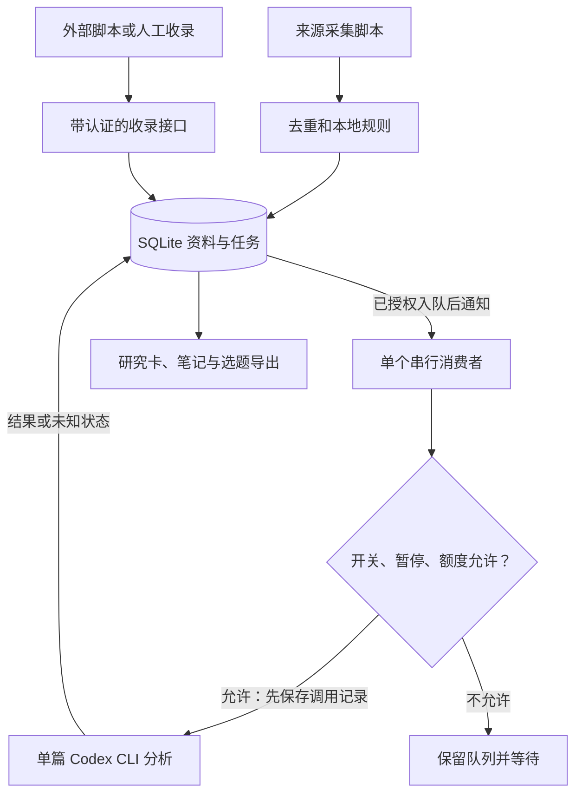

# T3 Code：哪些值得借鉴，哪些不采用

日期：2026-11-22。决定：**FDE 研究台独立运行；借鉴少量架构原则，当前不安装 T3、不嵌入 T3 源码、不增加 T3 运行依赖。** 本文替代早期“调研后直接采用 T3 作为总管”的方向。

## 1. 先按自己的需求做选择

当前目标是个人 FDE / 企业 AI 落地研究与公众号选题。资料量小；采集、去重、筛选、保存由程序完成；只有值得阅读的文章才交给模型。用户主要使用 Windows，Linux VPS 已有其他服务、资源紧张。

| 方案 | 能得到什么 | 需要承担什么 | 本轮判断 |
|---|---|---|---|
| 直接安装 T3，再把研究流程挂进去 | 成熟的开发会话、代码工作区、多 provider 和桌面入口 | 多维护一个平台与认证环境，研究资料和任务状态跨两个系统 | 当前收益不足；日后个人开发可单独试用 |
| 把 T3 的 server / provider 代码嵌入 FDE | 获得通用 Agent 工作台的一部分能力 | Effect、内部 contracts、app-server、持久事件与版本同步等耦合 | 不采用；这些不是独立小函数 |
| 在现有代码中实现少量原则 | 及时处理任务、跨平台 CLI、脚本可接入，保留现有数据和额度规则 | 维护少量明确边界的代码 | **本轮采用** |

研究台现有 SQLite 队列、调用收据、预算预留、缓存、失败暂停已经满足主要可靠性需求。它们是原有能力，不能记成此次从 T3 新增的功能。原版无待处理任务时也不会调用模型。

## 2. 源码依据与取舍

T3 审查基线为 [`pingdotgg/t3code@b427708`](https://github.com/pingdotgg/t3code/tree/b4277089795299da077e784f9f3432b3cc1c1c7d)。判断以固定提交的服务端执行链、持久化、provider、进程启动和外部触发代码为依据；不把所有桌面和移动界面的行为视为已经实机验证。

| T3 实现 | 有用的原则 | 在 FDE 中的处理 |
|---|---|---|
| [`EventSink.commitCommand`](https://github.com/pingdotgg/t3code/blob/b4277089795299da077e784f9f3432b3cc1c1c7d/apps/server/src/orchestration-v2/EventSink.ts) | 持久状态提交后，再通知任务执行器 | `store.queue()` 成功后调用 `worker.wake()`；启动时重读队列 |
| [`EffectWorker`](https://github.com/pingdotgg/t3code/blob/b4277089795299da077e784f9f3432b3cc1c1c7d/apps/server/src/orchestration-v2/EffectWorker.ts) | 通知及时唤醒，普通计时器补偿遗漏通知 | 单消费者连续处理；低频检查只读本地状态，不生成“有没有新任务”的模型对话 |
| [`EffectOutbox`](https://github.com/pingdotgg/t3code/blob/b4277089795299da077e784f9f3432b3cc1c1c7d/apps/server/src/orchestration-v2/EffectOutbox.ts) | 调度不能只依赖内存 | 保留 `articles.status` 和 `attempts`；不新增 outbox 或事件溯源框架 |
| [`shell.ts`](https://github.com/pingdotgg/t3code/blob/b4277089795299da077e784f9f3432b3cc1c1c7d/packages/shared/src/shell.ts) | 将操作系统启动方式与业务逻辑分离，处理 npm 启动器 | 新建原创 `codex-process.mjs`；识别官方 npm 布局后直接运行 JS 入口，保持 `shell:false` |
| [`CodexAdapterV2`](https://github.com/pingdotgg/t3code/blob/b4277089795299da077e784f9f3432b3cc1c1c7d/apps/server/src/orchestration-v2/Adapters/CodexAdapterV2.ts) | 业务与模型提供方应有清楚边界 | 继续用现有 `runAnalysis`；单篇任务用官方 `codex exec`，不引进长会话 app-server |

**本轮直接复制的 T3 源代码为零。** 新增运行代码为本项目独立实现，未新增第三方依赖。T3 的默认多并发、通用会话恢复、Git worktree、桌面 UI、移动客户端和多租户外观都不是当前研究流程所需。

将来真要复制具体函数时，应按实际文件检查依赖并保留 MIT 来源与版权说明；不能把“开源”理解成可以移除许可。当前没有复制行为，因此没有假造 T3 派生代码清单。

## 3. 本轮实际改动

1. **及时消费持久队列。** 原版人工入队在空闲时已经立即执行；缺口在于繁忙时新增任务、自动任务及后续队列。现在完成一项后继续检查下一项，多次唤醒合并，最大模型并发仍为一。
2. **采集和分析分开推进。** 慢来源不会阻塞已有分析任务。每个来源完成后可以补充自动队列，不需要等待所有来源结束。
3. **额度阻塞立即停止本轮处理。** 每日上限、月预算、暂停或未知结果都会退出消费循环。自动队列补充量扣除滚动 24 小时尝试数和已有排队项，暂停或满额时不持续扩张。
4. **Windows 进程边界。** 原生 `.exe` 可以直接调用；标准官方 npm `codex.cmd` / `codex.ps1` 解析到 `@openai/codex/bin/codex.js`，用 Node 直接启动。保留必要系统变量，隔离密钥与项目配置；超时针对本次进程树处理。
5. **外部脚本收录入口。** `npm run intake` 使用现有私有 HTTP API，默认只收录，显式 `--analyze` 才请求分析。外部采集器不持有 SQLite，不绕过预算，也不自动重试不明请求。
6. **人工正文修订保持人工选择。** 对已有自动采集文章补充新正文后，不再沿用自动分析资格；新结果需要明确排队。

SQLite `user_version` 仍为 1，没有结构迁移。采集、分析、自动分析的默认开关均未开启。失败和崩溃后的未知结果继续人工检查，不因采用“事件驱动”而自动重发。

## 4. 事件驱动到底指什么

来源没有 webhook 时，程序仍需按来源间隔检查 RSS 或网页。研究台每 60 秒检查到期来源和待处理队列；这个计时器不向模型提问。没有符合条件且已授权的任务，就没有模型分析请求。

外部监视程序如果已经拿到新内容，可以提交 JSON；研究台不需要再由一个大模型“总管”决定有没有事件。队列持久化解决重启后未处理任务的恢复；模型请求进行中崩溃，仍保留未知消耗并暂停。关机期间本机不能接收事件；当前没有实现云端邮箱、离线消息中继或常驻公网 webhook。

## 5. 企业 FDE 场景何时再考虑 T3

如果后续需求变成多个实施人员同时维护客户代码库、跨项目保留 Agent 会话、审批执行命令、管理远端开发环境，T3 值得作为**独立开发工作台**再评估。它的价值在这些工作流，而不是给每篇资讯摘要增加一层平台。

FDE 研究台可通过 [收录接口](EVENT_INTAKE.md) 与其他工具交换资料。先形成清楚的数据契约；只有真正出现长会话、工具调用和人工介入需求时，才评估 app-server 或通用 Agent 层。客户隔离、角色权限和企业审计需要另行设计，不能从桌面工作台直接推断已经具备。

部署建议：先 Windows 本机原生试运行；需要全天采集且 VPS 实测余量足够时，再整体迁移。不要同时让 Windows 与 VPS 写同一个 SQLite 文件。实际验证及未验证项见 [VALIDATION](VALIDATION.md)，后续任务见 [CODEX_HANDOFF](CODEX_HANDOFF.md)。
